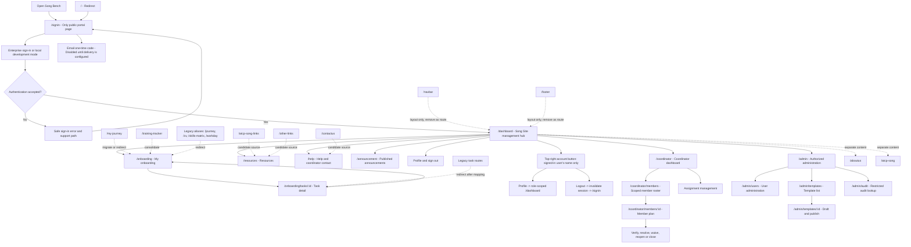
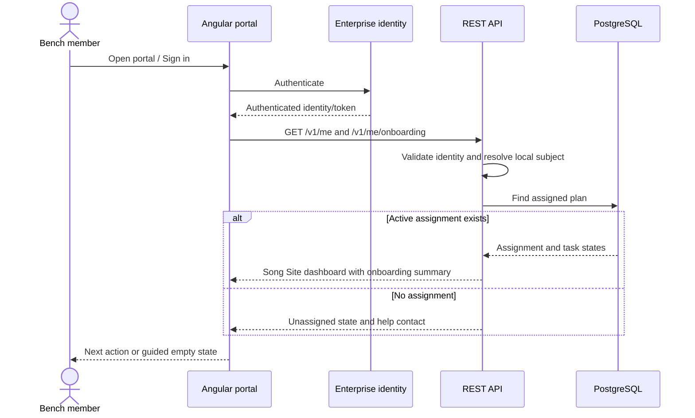
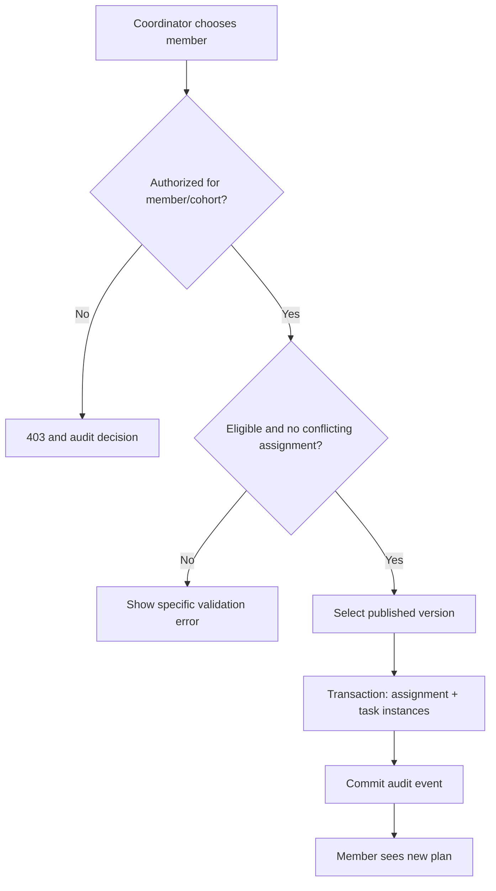
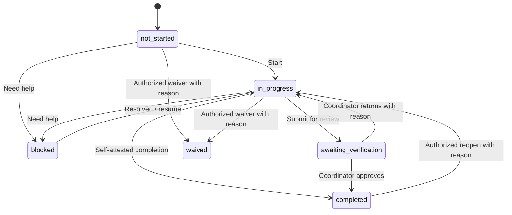
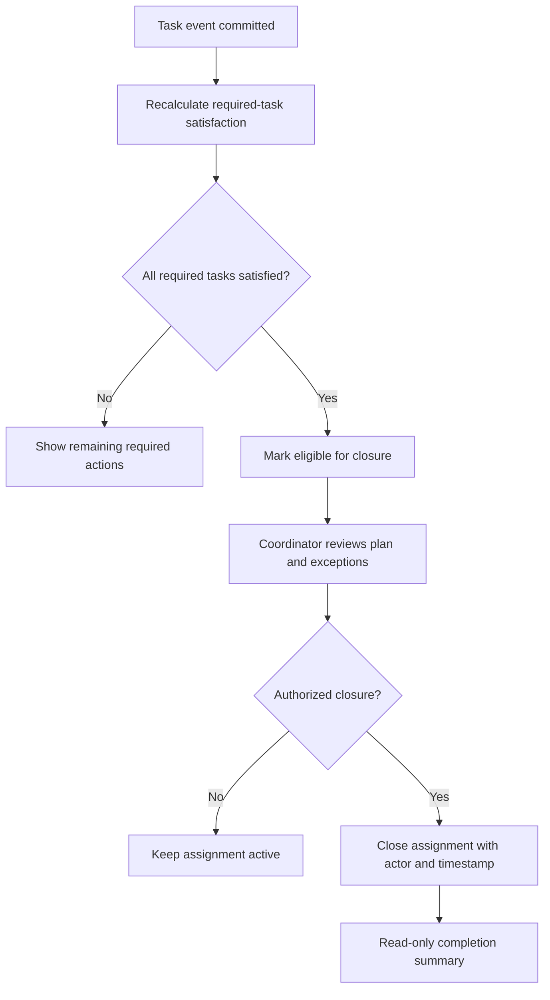
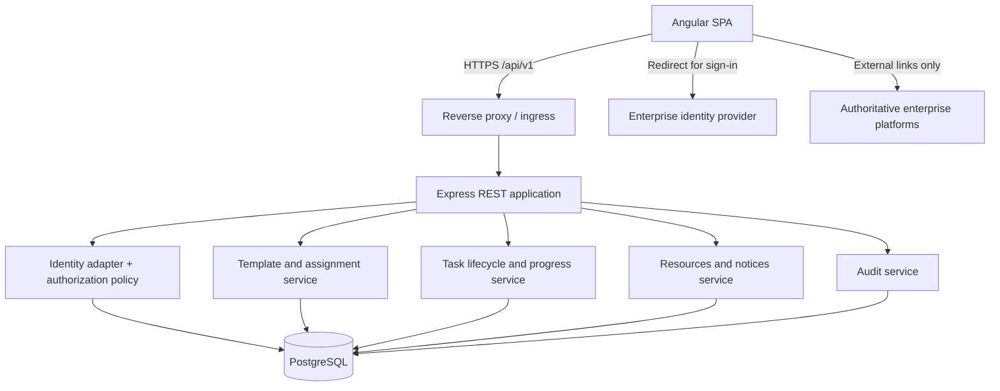
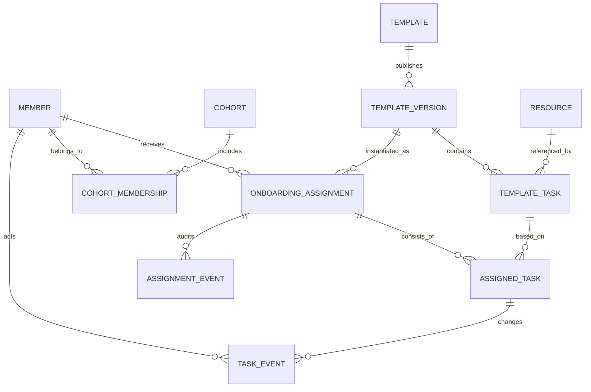
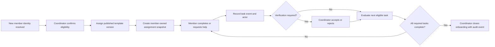
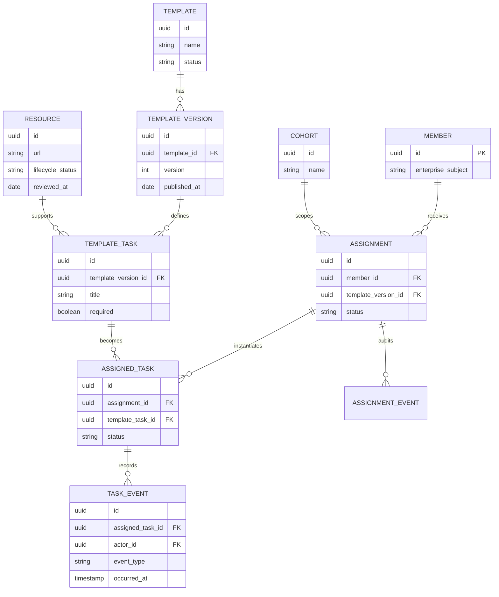

# Song Bench Onboarding Portal
## Solution Architecture Design (SAD)

**Document ID:** SONG-SAD-001  
**Version:** 1.1 (Principal Architect Review)
**Status:** Proposed bench-project baseline — requires product-owner and security approval
**Date:** 23 October 2026
**System:** Song Bench Onboarding Portal  
**Classification:** Internal working design — contains no production secrets

> **Purpose of this document:** Define the intended solution as if architecture work had preceded development. Existing code is treated as a source of evidence, **not** as a binding product specification. All target-state descriptions are proposals until approved and implemented. This is an architecture design, not a claim that the system currently satisfies it.

---

## Document control

| Item | Details |
|---|---|
| Business owner | Song Bench onboarding owner — to assign |
| Product owner | Bench coordinator representative — to assign |
| Architecture owner | Solution architect — to assign |
| Engineering owner | Application team — to assign |
| Reviewers | Identity/security, data/privacy, operations, accessibility, bench coordinators |
| Decision status | Proposed SAD; repository ADRs remain the governing decisions where accepted |
| Approval gates | Scope and flows; security and data; MVP acceptance; deployment readiness |

### Version history
| Version | Date | Change |
|---|---|---|
| 1.0 | 2026-10-20 | Reconstructed product-first architecture baseline from current repository and proposed target state |
| 1.1 | 2026-10-23 | Principal architect review of onboarding, dashboard, resource tracking, database/API evidence, ADRs and work packages; reduced scope to a bench-project MVP and recorded verified gaps |

### Reading guide
- **Current-state observation:** directly indicated by source files or existing documents.
- **Target design:** proposed functionality or engineering approach, not necessarily implemented.
- **Open decision:** needs accountable owner and formal approval.

---

# 1. Executive summary

Song Bench Onboarding Portal is a **small, secure bench-project application** for members entering Song Bench and for a limited coordinator group managing their onboarding. It should provide one clear place to find approved next steps, links and self-reported progress. It is not a general product platform, enterprise resource-management system, HR system, learning system, staffing system, or full CMS.

**Primary outcome:** A person joining the bench knows what to do next and can resume where they left off. A coordinator can see assigned-member progress and resolve blockers without changing another member's task state. This outcome is not yet supported by the current repository implementation; it is the target for the next approved work packages.

**Architectural choice:** Angular web client + versioned Express REST API + PostgreSQL relational persistence, deployed as a modular monolith. Reuse existing identity foundations and authoring infrastructure only where they contribute to the MVP. Security, identity resolution, and authorization are enforced server-side. SQLite may remain for fast local tests, but PostgreSQL is the qualified production database.

**Release gate:** Two different members must be able to complete the same template independently, through sign-out/restart, without cross-member data leakage; a coordinator must see correct scoped progress; and a member must not assign, approve, or alter another member's onboarding. The current task API and UI do not meet this gate because the implemented task tables are not assignment-owned.

# 2. Business context and problem definition

## 2.1 Problem statement

The existing application combines generic site pages, an individual-looking journey, task tracking, a training tracker, links, announcements, and privileged content editing. Its current API operations update shared task status, so the architecture cannot reliably support independent per-person onboarding progress. Documentation focuses heavily on technical decisions rather than defining a product journey end to end.

## 2.2 Business objectives

| ID | Objective | Measurable acceptance |
|---|---|---|
| BO-01 | One clear starting point | Song Site dashboard shows the user's available site areas, assignment summary and next action on first authenticated visit |
| BO-02 | Consistent onboarding | Approved templates produce consistent task sets and instruction versions |
| BO-03 | Individual accountability | Each task state and event is attributable to one assignment and actor |
| BO-04 | Operational visibility | Coordinator can view assigned members, outstanding required tasks, and blockers |
| BO-05 | Minimal operational burden | One administrator can update templates/resources without code changes for ordinary text/link edits |
| BO-06 | Trustworthy completion | Required tasks and approvals determine completion, not a manually edited percentage |

## 2.3 Intended benefits

Reduced onboarding ambiguity, fewer recurring coordinator questions, visibility into blocked tasks, and a durable completion record. No unsupported numerical efficiency or ROI claim is assumed.

## 2.4 Success measures

- Assignment coverage: eligible arrivals assigned an active plan.
- First-action rate: assigned members opening and beginning their plan.
- Completion rate and elapsed time by approved template, without punitive individual rankings.
- Blocker count and aging; unresolved tasks requiring coordinator intervention.
- Usability and reliability: end-to-end task flows and accessibility verification.

## 2.5 Current-state baseline

This section records repository evidence as of 23 October 2026. It is not a statement that the target architecture is implemented.

| Area | Current evidence | Status against this SAD |
|---|---|---|
| Landing and dashboard | `/home` loads `src/app/home/home.component.ts` with spotlight, quick announcements, navbar and footer; `/dashboard` is the authenticated management/profile hub | Public Home is implemented as a shared content hub; the ADR-0038 sidebar/status-card management hub and assignment-aware summary are not fully implemented |
| About Us | `/aboutus` renders hardcoded information cards | Implemented static content; authoring is not in the onboarding MVP unless approved |
| My Journey | `/my-journey` reads and mutates the legacy `tasks` resource through `/api/tasks*` | Implemented partial experience; no member/assignment ownership model is present |
| Training Tracker | `/training-tracker` is a separate API-backed `training_tasks` experience | Implemented partial experience; not an onboarding stage with assignment-specific state |
| Resource monitor/tracker | `my-asset-tracker` is one task/detail route that links to an external Asset Tracker; `task_links` and external URLs are present | No implemented resource inventory, monitoring, ownership, status reconciliation, alerting, or coordinator resource dashboard |
| Onboarding | No `/onboarding`, coordinator, assignment, member roster, resource directory, or help route exists in `src/app/app.routes.ts` | Target-only; the existing Journey is not evidence of a complete onboarding capability |
| Announcement | `/announcement` uses versioned published content and has draft, preview, publish, restore and audit capabilities | Implemented locally; production identity and release qualification remain incomplete |
| Contact Us | `/contactus` provides a client-side contact form; no persisted support workflow is assumed | Implemented presentation only; target support behavior requires a decision |
| Song links | `/atcp-song-links` reads categorized links from the API; `/other-links` remains static | Implemented content surfaces; target Resources consolidation requires approval |
| Leadership | `/atcp-song` reads leadership content from the API | Implemented content surface; separate from onboarding unless product scope changes |
| Coordinator workspace | No coordinator routes or assignment/verification UI exist | Target-only |
| Template and audit administration | No onboarding template editor or general audit lookup exists; announcement authoring is page-specific | Target-only except for announcement authoring foundation |
| Identity and storage | Backend-owned development fixtures, signed local sessions, RBAC tables, SQLite/PostgreSQL adapters and migrations exist; Entra production validation remains separate | Local foundation; PostgreSQL behavior and production identity remain qualification work |

The current Journey and Training Tracker data must not be presented as independent member completion. Legacy shared status is preserved or migrated only according to Section 16.

# 3. Scope and boundaries

## 3.1 In-scope MVP

1. Corporate sign-in and mapped member identity.
2. One active onboarding assignment per member per defined onboarding cycle.
3. Template-driven stages, required/optional tasks, sequencing, and instructions.
4. Personal task transitions and stored completion evidence metadata.
5. External resource links and help/contact pathways.
6. Coordinator member directory, assignment, progress, blocking, verification and closure.
7. Administrator template publication and limited resource management.
8. Audited changes, standard errors, telemetry and basic operational runbooks.

## 3.2 Explicitly out of scope for MVP

- Replication or editing of HR records, talent profiles, skills inventories, curricula, or corporate compliance records.
- Automated synchronization of completion from external platforms without sanctioned APIs.
- Employee performance scoring, project staffing/ranking, talent matching, timesheets, approval hierarchies, social feeds, organization chart, AI tutors, autonomous agents, general-purpose CMS, custom form builder, or mass messaging.
- Broad role management UI unless existing authorized identity administration cannot satisfy access requirements.
- Storage of CV files or sensitive compliance evidence by default.

## 3.3 System context and ownership

| System/actor | Relationship | Authority |
|---|---|---|
| Member browser | Interacts with portal | Own task self-reporting where allowed |
| Bench coordinator | Assigns and verifies | Assignment and verification authority within assigned scope |
| Administrator | Configures templates and reference material | Publishing and configuration authority |
| Enterprise identity provider | Establishes authenticated employee identity | Identity authority |
| HR, learning, skills and compliance systems | External destinations (links at MVP) | Authoritative for their underlying business data |
| Portal database | Stores onboarding plans and portal event history | Authoritative only for portal-specific assignment/progress |

**Important boundary:** A self-reported click on “done” is *not* proof that an external training or compliance system shows completion. Tasks requiring validation must use coordinator verification or a subsequently approved integration.

# 4. Stakeholders, actors and access model

| Actor | Can view | Can change | Cannot do |
|---|---|---|---|
| Unauthenticated visitor | Sign-in page and approved authentication error/help information only | Nothing persisted | Read member/coordinator records or access authenticated pages |
| Member | Own active plan, own task history and public resources | Own eligible task states, support request | Edit templates, approve own verification, see another member's plan |
| Coordinator | Authorized cohort/assigned member plans, blockers and reports | Assign template; verify/reopen tasks; close onboarding with reason | Edit global role grants or bypass policy |
| Administrator | Published/draft templates and resource catalog | Draft/publish templates and manage authorized settings | Fabricate member completion or bypass auditable approvals |
| Support operator (optional) | Limited diagnostics | Approved support operations | Access sensitive evidence by default |

Coordinator assignment scope is mandatory in multi-coordinator use. Roles are not sufficient by themselves: all data access checks must additionally enforce **resource ownership or cohort membership**. Default deny on missing mapping.

# 5. Functional architecture and requirements

## 5.1 Capabilities

| ID | Capability | MVP priority | Behavior |
|---|---|---|---|
| FR-01 | Sign in | Must | Resolve enterprise subject to local member ID; show safe error on mismatch |
| FR-02 | Song Site dashboard | Must | Site navigation, spotlight and announcements, plus assignment summary, required tasks, next action, blockers and help when onboarding is assigned |
| FR-03 | Assigned plan | Must | Immutable snapshot of published template/version at assignment |
| FR-04 | Task lifecycle | Must | Mark start, self-complete, request help, add permitted completion note |
| FR-05 | Verification | Must | Coordinator accepts/rejects tasks requiring verification; reason and actor captured |
| FR-06 | Assignment | Must | Coordinator enrolls member from eligible roster/mapped identity; prevent duplicates |
| FR-07 | Progress | Must | Derived from required tasks and verification, not stored as editable percentage |
| FR-08 | Exception handling | Must | Blocked, waived with reason/authority, reopened, overdue advisory indicator |
| FR-09 | Resource links | Must | Relevant instructions and canonical links on each task |
| FR-10 | Coordinator view | Must | Search/filter by assigned scope, state, stage and blockers |
| FR-11 | Template publishing | Must | Draft and publish controlled template versions; no retroactive silent change |
| FR-12 | Audit trail | Must | Who changed what, for whom, when, prior/new state, reason where required |
| FR-13 | Announcements | Should | Read published notices; editing can initially use existing guarded feature |
| FR-14 | CSV reporting | Later | Authorized export with privacy/data minimization and retention controls |
| FR-15 | Notifications | Later | Reminder/alert only after channel, opt-out and governance decisions |

## 5.2 Content model and proposed onboarding stages

These stages are **starter content for review by actual bench owners**, not assertions about official policies. Each task has title, why it matters, procedure, external URL (if applicable), owner, required flag, dependency, expected effort (optional), verification rule, help contact, and last review date.

| Stage | Example tasks | Evidence/verification approach |
|---|---|---|
| 1. Welcome & orientation | Read bench guide; understand points of contact and support path | Self-attestation |
| 2. Personal readiness | Confirm contact guidance; review profile/update instructions | External link + self-attestation; never copy protected personal data |
| 3. Skills & learning | Visit skills profile; review relevant learning paths; record next learning action | Self-attestation or coordinator verification as needed |
| 4. Engagement readiness | Review CV/profile preparation guidance; understand resource and availability processes | External link and limited completion status |
| 5. Review & closeout | Resolve open blockers; coordinator reviews all required items | Computed eligibility + coordinator close action |

No stage should be renamed to imply that the portal certifies external-system completion.

### 5.3 Multi-access Sign In

Not every intended user is assumed to have organizational Microsoft Entra access. Under ADR-0040, `/signin` is the only unauthenticated portal page and `/` redirects to `/signin`. The Sign In page has provider-specific paths with explicit boundaries:

- Microsoft Entra SSO is the intended Production Mode path for organizational users, but backend token verification and principal mapping remain unimplemented.
- Email one-time-code sign-in with self-registration is the selected non-SSO direction. Its UI remains disabled until email delivery, verification, activation and authorization policy are implemented.
- Local Development Mode is available only on the local development server through the server-controlled fixtures in ADR-0035. It is not a production login and is rejected in public deployments.
- No anonymous Home, guest-browsing, or public data-reading path is available. All routes except `/signin` and all portal data APIs require a backend-authenticated session.

The sign-in screen and authenticated account-menu wireframe are in [Sign In Multi-Access Mockup](mockups/sign-in-multi-access.md). The authenticated header has no Sign In button. Its account button displays only the signed-in user's name from the trusted session/me response; Profile appears only as a dropdown option. The dropdown provides Profile → `/dashboard` and Logout → invalidate the session and return to `/signin`. Profile is available to all authenticated roles, but dashboard data and tools are role-scoped: administrators see authorized management capabilities, while members see limited member-scoped content. The browser cannot select a role or create a principal.

All authenticated users land on the same `/dashboard` route after sign-in. `/dashboard` is the authenticated profile/management destination, not the public landing page. Dashboard behavior is role- and scope-aware: regular members see only their own onboarding/task data; POCs/leads see only approved team or cohort data; administrators see authorized operational and management data; and local Development Mode identities receive only their fixture permissions. The backend resolves and enforces these scopes. Role labels, sidebar visibility and client filters cannot expand access. The current bench implementation provides the shared shell and limited server-derived summary cards; full member, POC/lead and administrator dashboard datasets remain implementation work.

# 6. User experience and end-to-end process flows

## 6.1 Global navigation

- **Member:** Dashboard → My Onboarding → Task Detail → Resources & Help → top-right account menu: current user's name only → Profile (their limited member dashboard) → Logout.
- **Coordinator:** Coordinator Dashboard → Members → Member Onboarding → Verify/Resolve → Assignment Management.
- **Administrator:** Templates → Draft/Edit → Preview → Publish → Resources → Audit.
- Visible options follow roles, while the backend remains the actual security boundary.
- Empty/no-plan state must say *No onboarding assigned* and provide the correct coordinator contact, not show misleading 0% progress.

### 6.1.1 Navigation map

This map shows the target navigation together with the existing pages that remain
visible during migration. Solid paths are target navigation; dashed paths are
legacy redirects or separate content surfaces. Role visibility is a usability
decision only; every destination remains server-authorized.



The dashed content relationships are not automatic conversions. Each requires a
named owner, canonical API, authorization rule, review lifecycle and approved
redirect or retention decision before the existing route is changed.

### 6.1.2 Dashboard shell contract

`/dashboard` is the authenticated Song Site management hub. It is a shared shell
for status summaries and authorized tool navigation; it is not the source of
truth for domain status, roles or permissions.

- Status cards show server-derived summaries such as onboarding progress and blockers, pending content/template work, authorized user/access work and operational notices. A card is shown only when its data and permission are available.
- The primary sidebar contains authorized tools such as My Onboarding, User Management, Roles, Permissions, Templates and Audit. Tool routes are added only with an API contract, permission, owner, work package and acceptance tests.
- A visible separator divides the primary tools from the lower utility section. The lower section contains a settings icon for authorized user/application settings.
- The sidebar expands and collapses without changing the route or domain state. Collapsed mode displays icons only; every icon has an accessible name and tooltip or equivalent discoverable label.
- Sidebar preference is presentation state only. It may be persisted per browser, but it must not store permissions, role decisions or authoritative status.
- The shell inherits the existing Song Site theme tokens, typography, spacing, focus styles and responsive behavior. Dashboard-specific theme forks are not permitted.
- Status cards and tools define loading, empty, stale, failure, forbidden and unavailable states. A missing permission must not be represented as a misleading zero or empty status.
- Keyboard navigation, visible focus, screen-reader names, responsive breakpoints and expanded/collapsed behavior are release-tested.

## 6.2 Flow A: First visit and assignment

**Preconditions:** User has an identity-provider account and is eligible for onboarding; template published.



**Exception paths:** Invalid session → sign-in; unrecognized identity → contact support without auto-provisioned privileges; inactive assignment → historic read-only view; unavailable API → error/retry, never fabricated completion.

## 6.3 Flow B: Coordinator creates onboarding assignment

1. Coordinator signs in; server checks `onboarding:assign` and allowed cohort.
2. Coordinator selects eligible member and active published template.
3. System checks duplicate active cycle, eligibility and existing assignment.
4. In a transaction, it creates assignment, copies/version-pins template tasks, and initializes all task states to `not_started`.
5. System records who assigned, template version, date, and audit event.
6. The Song Site dashboard shows the assigned journey summary on next refresh.

**Exceptions:** Duplicate request returns existing assignment or conflict deterministically; unpublished template rejected; out-of-scope coordinator gets 403; partial failure rolls back transaction.



## 6.4 Flow C: Member performs and completes a task

1. Member opens own plan; API returns task instances scoped to caller.
2. Member opens task and reads its goal, instructions, references, acceptance rule and help contact.
3. Member chooses `Start`, opening `in_progress`, or `Need help`, opening `blocked` with optional safe description.
4. For a self-attested task: user submits `Complete`; backend validates allowed transition and writes `completed`.
5. For a verified task: user submits `Ready for review`; backend writes `awaiting_verification`, not `completed`.
6. System atomically adds a state history/audit event and returns recalculated progress.
7. Member sees the next actionable required task; dependencies stay unavailable until cleared, with explanation.

**Exceptions:** Repeated submit is idempotent; stale version returns 409 and reload instruction; invalid notes are rejected; disabled/offboarded account cannot mutate.



`waived` fulfills a requirement only if an explicit policy says waived tasks count as satisfied; it remains visible and attributed. Unverified `awaiting_verification` never counts as complete.

## 6.5 Flow D: Coordinator monitors and resolves blockers

1. Coordinator opens cohort view and filters `blocked` or `awaiting_verification`.
2. API enforces cohort membership before returning member summaries.
3. Coordinator opens a member's plan with latest activity, tasks and permitted comments.
4. For verification, coordinator approves or returns task with reason; self-verification of coordinator's own task is prohibited where independent review is required.
5. For blocker resolution, coordinator records instruction/action and transitions task to `in_progress`, or applies an authorized waiver with mandatory reason.
6. Member subsequently sees updated task state and explanation.

## 6.6 Flow E: Completing the onboarding assignment



A percentage reaching 100 does **not** automatically imply coordinator closure. Completed assignments remain accessible under retention policy; reopening requires an explicit authorized transition and reason.

## 6.7 Flow F: Administrator edits/publishes template

Draft → edit stages/tasks/dependencies/instructions → validate (required fields, valid links, no dependency cycles) → preview as member → publish immutable version → available for *new* assignments. Existing active plans keep pinned version; any migration to a newer template requires a distinct, authorized migration process with audit, not silent mutation.

## 6.8 Flow G: Offboarding, re-entry, and exceptional cases

- An inactive user cannot create new task events; retained history follows retention rules.
- Member returning for a new cycle receives a new assignment; prior cycle preserved separately.
- Template retired: cannot be selected for new assignments, but existing assignments remain readable.
- Removed external link: task shows reviewed alternative/help contact; completion status is not erased.
- No internet/failed external platform: portal can record `blocked`, not claim external requirement complete.

# 7. Information architecture and screen inventory

| Route (proposed) | Screen | Primary functions | Access |
|---|---|---|---|
| `/home` | Existing Home content | Spotlight and announcements | Authenticated |
| `/` | Sign-in redirect | Redirects to `/signin` | Public redirect only |
| `/signin` | Sign-in page | Entra sign-in, disabled email one-time-code option, local-only Development Mode, safe support/error path | Only unauthenticated portal page |
| `/dashboard` | Song Site management hub and profile destination | Server-derived status, role-aware navigation and authorized workspace entry points | Authenticated user |
| `/onboarding` | My plan | Ordered stages, filters, status | Member |
| `/onboarding/tasks/:id` | Task details | Instructions, links, state change, request help | Owner |
| `/resources` | Resource directory | Curated links, owner, review date | Authenticated |
| `/help` | Help | Coordinator contact and escalation | Authenticated |
| `/coordinator` | Cohort dashboard | Pending review, blockers, summary | Coordinator |
| `/coordinator/members` | Member roster | Search, assignment | Coordinator scoped |
| `/coordinator/members/:id` | Member plan | Verify, waive, resolve, close | Coordinator scoped |
| `/admin/templates` | Templates | Draft/publish/retire | Administrator |
| `/admin/templates/:id` | Template editor | Stages, dependencies, publish checks | Administrator |
| `/admin/audit` | Audit lookup | Restricted investigation | Authorized admin |

**Consolidate existing duplicated Journey and Training Tracker experiences** into a single task presentation with stage/category metadata. Avoid exposing implementation-centric page names in primary navigation.

### 7.1 Existing route disposition

The following routes are current product surfaces or compatibility paths. They are inputs to migration, not additional target workspaces.

| Existing route | Current purpose | Target disposition | MVP decision required |
|---|---|---|---|
| `/home` | Existing Song Site landing page with shared spotlight and announcements | Keep behind authentication; no anonymous read access | Decide whether to retain or redirect after authenticated content review |
| `/dashboard` | Authenticated Song Site management hub and profile destination | Retain as the canonical authenticated management hub; add assignment-aware onboarding summary without making it the task-detail surface | Define role-specific cards, data loading boundaries and empty/no-assignment behavior |
| `/aboutus` | Static corporate information cards | Retain as informational page outside onboarding workflow | Confirm content owner and whether updates require authoring |
| `/my-journey` | Current member-looking Journey task grid | Redirect to `/onboarding` after assignment APIs are qualified | Define legacy read-only period |
| `/training-tracker` | Separate training task grid and completion view | Consolidate as a stage/category within `/onboarding` | Define parent-task and history migration |
| `/my-cv`, `/my-skills-matrix`, `/my-mycompetency`, `/my-myriro`, `/my-workday`, `/my-asset-tracker`, `/my-update-contact`, `/people-lead`, `/my-compliance`, `/wd-update-contact`, `/my-learning-platform` | Individual legacy task pages and external links | Redirect or render task detail from `/onboarding/tasks/:id` | Map each route to an approved template task |
| `/announcement` | Published notices, training content and page-specific authoring | Retain as a separate content page; link from dashboard where appropriate | Confirm whether notices are onboarding resources or general site content |
| `/atcp-song-links` and `/other-links` | Song and external resource links | Consolidate into `/resources` only after ownership and review metadata exist | Approve canonical resource catalog |
| `/contactus` | General contact form | Retain or redirect to `/help` | Decide persistence, routing and support SLA |
| `/atcp-song` | Leadership and capability content | Retain as a separate content surface | Confirm whether it is part of onboarding MVP |
| `/atcp-song2`, `/song3`, `/song-bench` | Other existing site experiences | Retain, redirect, retire or exclude explicitly | Product owner disposition required |
| `/journey`, `/cv`, `/skills-matrix`, `/mycompetency`, `/workday` | Compatibility aliases | Preserve redirects during migration, then retire after consumer verification | Define deprecation window |
| `/navbar`, `/footer` | Layout components exposed as routes | Remove from navigable route inventory | Confirm no external consumers |

No route is considered migrated until its redirect/read-only behavior, owner, target API, authorization rule, and removal evidence are documented.

### 7.2 Target page states

Every authenticated target page must define loading, empty, forbidden, not-found, API failure/retry, expired-session, and read-only states. In addition:

- `/dashboard` and `/onboarding` show **No onboarding assigned**, not false zero progress.
- `/dashboard` status cards and sidebar tools are filtered by server-resolved permissions; unavailable data is not rendered as a zero or success state.
- Task detail shows dependency blocking, awaiting verification, returned-for-rework, waived, completed, and stale-version conflict states.
- Coordinator pages show out-of-scope denial without revealing whether an inaccessible member exists.
- Template editing shows validation errors, dependency-cycle errors, publish conflicts, preview, and immutable-version confirmation.
- `/resources` and `/help` show stale or unavailable links honestly and provide an owned escalation path.

# 8. Logical application architecture



## 8.1 Component responsibilities

| Component | Ownership | Key rule |
|---|---|---|
| Angular UI | Navigation, accessible forms, present server state | No authoritative role/progress calculation |
| Identity adapter | Validate tokens/session; map stable subject | Never accept client-supplied user ID as identity |
| Policy layer | RBAC plus resource/cohort permissions | Fail closed and enforce on every read/write |
| Template service | Validate and publish immutable versions | Assignment pins template version |
| Assignment service | Enrollment and cycle lifecycle | Transactional, avoids duplicate active plans |
| Task service | Transition validation and task instance writes | All state changes audited and optimistic-locked |
| Progress projection | Computes remaining, completed and closure eligibility | Deterministic from task instance states |
| Resource service | Canonical links/instructions ownership | Review/expiry metadata |
| Audit service | Immutable event trail | No secrets or sensitive unneeded payloads |
| Repository/database | Transactions and migrations | PostgreSQL authoritative in production |

## 8.2 Deployment architecture

Angular static build served behind HTTPS reverse proxy; `/api/v1` routes to stateless Express instances; PostgreSQL on managed or approved internal database service with backups and restricted networking; enterprise identity provider handles sign-in. Browser never connects to database. Health/readiness probes and structured logs are exposed only to approved operations. Exact cloud subscription, DNS, network and secret manager are deployment decisions, not invented facts in this document.

## 8.3 Constraints and implementation principles

Modular monolith; API-first contracts; validated input; single source of truth; no cross-user state; no hidden automatic external data sync; controlled template versions; privacy by design; tested restore; accessible responsive UI; no AI or async orchestration requirement in MVP.

# 9. Data architecture

## 9.1 Conceptual entities



## 9.2 Proposed entity dictionary

| Entity | Key fields | Semantics |
|---|---|---|
| `members` | id, enterprise_subject UNIQUE, display_name, active | Local identity mapping, minimal profile |
| `cohorts` | id, code, title, status | Coordinator scope/group |
| `cohort_memberships` | member_id, cohort_id, effective dates | Prevents access to unrelated members |
| `templates` | id, name, status | Stable onboarding definition |
| `template_versions` | id, template_id, version, published_at, published_by | Immutable released definition |
| `template_tasks` | id, template_version_id, stage, title, order, required, verification_mode, dependency_ids, instructions, resource_id | Published task requirements |
| `assignments` | id, member_id, template_version_id, cycle_key, cohort_id, assigned_by, assigned_at, status, closed_at | Personal onboarding instance |
| `assigned_tasks` | id, assignment_id, template_task_id, status, version, updated_at, completed_at | Member-specific task status |
| `task_events` | id, assigned_task_id, actor_id, event_type, from_status, to_status, reason, timestamp | Append-only transitions |
| `assignment_events` | id, assignment_id, actor_id, event_type, reason, timestamp | Assignment audit |
| `resources` | id, title, url, owner, reviewed_at, status | Curated links and help material |

Identity IDs should not be email addresses: use stable provider subject and map internally. Add unique `(member_id, cycle_key)` where business cycle semantics allow; otherwise use a partial uniqueness constraint for one active assignment per cycle. Index assignment by member/cohort/status and task by assignment/status. Use foreign keys, migration versioning, constrained states and server timestamps.

## 9.3 Data rules

1. Published template versions are immutable; assignment snapshots reference the exact version.
2. A member may only mutate tasks attached to their own active assignment and in permitted status transitions.
3. Every task change and coordinator override creates an append-only history record in the same transaction.
4. Persist task state, not a separately editable percentage. Progress is derived, cached only with clear invalidation if performance warrants.
5. External system completion is never inferred from page visits or raw links.
6. No uploaded sensitive documents in MVP. Store minimum required evidence metadata, not corporate records themselves.
7. Data retention and deletion schedules require privacy owner approval before rollout.

## 9.4 Progress formula

`progress = satisfied_required_tasks / total_required_tasks × 100` (where `satisfied` means `completed` or an explicitly authorized counting waiver); if there are zero required tasks, show `Not configured`, not 100%. Optional items display separately. Closure status is distinct from progress.

# 10. Interface and integration architecture

## 10.1 REST API outline (proposed `/api/v1`)

| Method | Endpoint | Purpose | Authorization |
|---|---|---|---|
| GET | `/me` | Identity and role context | Signed in |
| GET | `/me/onboarding` | My active/historic assignment summary | Member owner |
| GET | `/me/onboarding/tasks` | Personal tasks/stages | Member owner |
| GET | `/me/onboarding/tasks/{id}` | Details/instructions | Member owner |
| POST | `/me/onboarding/tasks/{id}/transitions` | Start, complete, block, submit for review | Member owner |
| GET | `/resources` | Published resources | Signed in |
| GET | `/coordinator/members` | Authorized member roster and filters | Coordinator cohort |
| POST | `/coordinator/assignments` | Assign published template | Coordinator cohort |
| GET | `/coordinator/assignments/{id}` | Assignment and task details | Coordinator cohort |
| POST | `/coordinator/tasks/{id}/decisions` | Approve, return, waive, reopen | Coordinator cohort |
| POST | `/coordinator/assignments/{id}/close` | Close eligible assignment | Coordinator cohort |
| GET | `/admin/templates` | List drafts/published | Administrator |
| POST | `/admin/templates` | Create draft | Administrator |
| PUT | `/admin/templates/{id}/draft` | Revise draft | Administrator |
| POST | `/admin/templates/{id}/publish` | Validate/publish version | Administrator |

POST transition example:

```json
{
  "action": "submit_for_verification",
  "expectedVersion": 3,
  "note": "Completed the required step in the linked system"
}
```

Response includes stable task ID, status, incremented version, UTC time, and derived assignment summary. Use HTTP 400 validation, 401 unauthenticated, 403 unauthorized, 404 inaccessible/unknown as policy permits, 409 stale state, 422 illegal transitions, 429 throttled, and 5xx internal failures. Return correlation ID in each error; never leak personal records or token details.

## 10.2 Integration boundaries

- **Identity:** Trust validated enterprise authentication only; verify issuer, audience, signature, expiry and mapped subject. Local development identity must be disabled outside loopback development.
- **External resources:** curated links. No unauthorized APIs or screen scraping. Add deep links only where approved.
- **Future integrations:** separate versioned adapters after formal data owner, permission, reconciliation and failure-mode review.

# 11. Security, privacy and compliance design

- HTTPS in production; secure browser session/token handling appropriate to the approved identity topology; no tokens in URLs or logs.
- Resource-level authorization checked for every endpoint, independent of client route guards.
- Least-privilege coordinator scoping, author/publisher separation, and mandatory reasons on override actions.
- Validate input schema, enforce size/length limits, sanitize or escape displayed notes, protect against injection and CSRF where cookie sessions are used, throttle sensitive endpoints.
- Database credentials in approved secrets storage; encryption at rest/in transit, backups, restricted access; rotate credentials through standard operations.
- Minimize PII: member identifier/name, cohort, progress and workflow events only. Do not collect health, financial, skills assessment contents, CV documents or confidential HR material.
- Maintain immutable audit history with redacted payloads and access logs, authorized viewing, retention approval.
- Privacy/security review must decide retention, lawful/internal basis, subject access and deletion handling, and monitoring boundaries before go-live.

# 12. Quality attributes and non-functional requirements

| ID | Attribute | Design/acceptance target |
|---|---|---|
| NFR-01 | Availability | Service-level objective to be agreed by operations; graceful errors, no false completion |
| NFR-02 | Performance | Target p95 API response under 500 ms for normal reads at agreed load (excluding external sign-in); measure in staging |
| NFR-03 | Data integrity | Zero cross-member updates; all state/audit writes atomic |
| NFR-04 | Reliability | Recover after restart with identical persisted state |
| NFR-05 | Security | No high/critical unresolved security findings at release; negative authorization tests |
| NFR-06 | Accessibility | WCAG 2.2 AA design target; keyboard flow and screen reader verification |
| NFR-07 | Observability | Correlation ID, structured logs, health/readiness, error and DB latency metrics |
| NFR-08 | Recoverability | Defined backup schedule, tested restore, approved RPO/RTO prior to production |
| NFR-09 | Maintainability | Modular domain services and migrations; documented configuration/runbooks |
| NFR-10 | Compatibility | Supported enterprise desktop/mobile browsers per owner-approved matrix |
| NFR-11 | Privacy | Minimized fields and bounded access/reporting; retention policy approved |

# 13. Operations and lifecycle management

## 13.1 Environments

**Local:** Angular + Express + SQLite optional for rapid tests; development authentication loopback only.  
**CI/integration:** Automated unit, API contract and database migration tests; production-database parity against ephemeral PostgreSQL.  
**Staging:** Production-like reverse proxy, enterprise auth, PostgreSQL, seeded nonproduction users; browser E2E including role separation.  
**Production:** Approved ingress, secrets, monitoring, backup/restore, incident ownership and rollback strategy.

## 13.2 Deployment and rollback

Build immutable frontend/backend artifacts; run lint/typecheck/unit/integration/E2E and dependency scans; migrate DB using backward-compatible steps; deploy to staging; run smoke tests with separate member/coordinator accounts; approve production; monitor errors and successful sign-in/task transitions. Roll back binaries via deployment strategy, not destructive DB rollback. Data migrations require tested rollback or forward-fix strategy.

## 13.3 Operational support

Maintain owner directory and incident escalation; log correlation IDs without raw identity tokens; separate user errors from server faults; track failed sign-ins, 403 trends, transition conflicts, migration failures, high latency and stale links. Task history is the principal operational troubleshooting source for progress discrepancies.

# 14. Verification strategy and acceptance scenarios

| Test ID | Scenario | Expected result |
|---|---|---|
| AT-01 | Member A and B share template | Different task instance IDs and independent progress |
| AT-02 | A completes required self-attested task | Only A changes; audit created; progress recalculates |
| AT-03 | A tries B's task ID | Access denied; no B data leaked or updated |
| AT-04 | B submits verification-required task | Pending review, not counted complete |
| AT-05 | Coordinator approves eligible B task | B task becomes completed with decision actor/reason history |
| AT-06 | Coordinator outside B cohort tries approval | 403 and no mutation |
| AT-07 | Browser refresh, logout/login, API restart | Same persisted assignment states and history |
| AT-08 | Duplicate assignment request | Deterministic nonduplicate result, no duplicate tasks |
| AT-09 | Task update with stale version | 409, no overwritten state |
| AT-10 | Template v2 published | Existing v1 assignment unchanged; new assignment receives v2 |
| AT-11 | All required tasks complete but not closed | Eligible for closure but still active until coordinator closes |
| AT-12 | Blocked/waived/reopened task | Valid transitions only, mandatory reason and audit |
| AT-13 | Auth expired and dev mode production request | Secure rejection and no insecure bypass |
| AT-14 | External resource unavailable | User receives honest retry/help path, no automatic completion |
| AT-15 | Accessibility/keyboard journey | All MVP primary flows operable and understandable |
| AT-16 | PostgreSQL migration and backup restore | Constraints and prior state survive migration/restore |

**Definition of Done:** The full journey is demonstrated on staging with two separate members, one coordinator, an approved template, verification-required item, blocker, closure, persistence, negative authorization cases and documented release evidence.

# 15. Repository assessment and fit-gap analysis

These observations are **not** target design requirements. They identify what may be reused or retired.

| Existing element | Evidence | Current fit | Target action |
|---|---|---|---|
| Angular standalone routes | `src/app/app.routes.ts` | Multiple legacy and duplicate navigation paths | Consolidate around member/coordinator/admin workspaces |
| My Journey screen | `src/app/song-bench/my-journey/` | Presentation basis; not evidence of independent per-user progress | Refactor to assignment-instance APIs |
| Training Tracker | `src/app/song-bench/training-tracker/` | Overlapping state/progress concepts | Merge as category/stage in same plan |
| Task/progress API | `backend/server.js` GET `/api/tasks`, PUT status, GET progress | Shared task mutation model | Replace with owned assigned-task transition APIs |
| User-progress table | `backend/migrations*/005-relational-content.sql` | Partial schema seam, not authoritative active workflow | Evaluate migration/replacement with explicit assignments |
| Identity and development auth | `backend/auth/`, ADR-0035 | Useful basis, requires production verification | Preserve fail-closed identity boundary |
| RBAC | migrations and authorization tests | Useful permission foundation | Add ownership and coordinator-cohort checks |
| Announcement authoring | `backend/content/`, ADR-0036/0037 | Secondary value vs onboarding core | Retain read-only at MVP, defer extensive authoring |
| API documentation | `docs/openapi/song-site.yaml` | Existing contract reflects old operations | Publish new versioned onboarding endpoints |
| ADR library | `docs/adr/` | Extensive point decisions, no singular product-first design | Ratify SAD and align/change superseded ADRs |
| Deployment docs | `docs/runbooks/`, CI workflows | Useful operational assets | Qualify against staging and production checks |

### Document consistency risks

- `docs/navigation-flows.md` refers to local/demo routing and a planned user-admin experience; published documentation must distinguish runtime facts from proposals.
- Existing route names include `/journey` and `/my-journey`; the new user model must deliberately migrate or redirect rather than preserve conflicting semantics.
- Separate SQLite/PostgreSQL schema evolution has parity risks; production behavior needs dedicated PostgreSQL integration tests.

### Existing page and content decisions

`/resources` is the target authenticated resource directory. It may reuse `/atcp-song-links` and `/other-links` content only after records have an owner, canonical URL, review date and lifecycle status. `/help` is the target onboarding support surface; `/contactus` may provide its presentation only if a support owner, routing behavior and data-retention rule are approved. General corporate pages such as `/aboutus`, `/announcement` and `/atcp-song` remain separate content surfaces unless the product owner explicitly moves them into the onboarding MVP.

The accepted user-administration design in [ADR-0015](adr/0015-user-administration-experience.md) remains distinct from onboarding template administration. `/admin/users` manages identities, roles and account state; `/admin/templates` manages onboarding definitions; `/admin/audit` is a restricted investigation surface across approved event types. These routes require separate permissions and must not be merged by navigation convenience.

# 16. Migration strategy from the current application

**Phase 0 — Baseline and stop scope growth.** Approve business flows, task catalog owners, template/assignment lifecycle, privacy review, and this SAD. Freeze unrelated page features. Capture current data for migration study.

**Phase 1 — Domain foundation.** Implement member mapping, cohorts, templates/versions, assignments, task instances, events, owner-scoped authorization, transactions and migrations. Add two-user API tests.

**Phase 2 — Real member journey.** Replace shared progress APIs behind new Angular dashboard/task pages; support self-attested and verification-required states; instructions, links and help; resume/restart tests.

**Phase 3 — Coordinator and administration.** Add assignment, review, blockers, waiver, closure, template draft/publish, scoped reporting and immutable change history.

**Phase 4 — Qualification and cutover.** Enterprise auth integration, PostgreSQL staging, security/privacy testing, cross-user E2E, backup/restore and smoke test. Redirect legacy URLs. Remove unsafe mutation endpoints after audit. Announce controlled pilot.

**Phase 5 — Legacy retirement and content governance.** Confirm zero approved consumers of compatibility routes, publish deprecation notices, preserve required history read-only, retire unsafe shared-task mutations, assign owners to resources/help/content pages, and verify stale-link review. No legacy route is removed solely because a replacement page exists.

### Data migration decision

Do **not** blindly reinterpret shared legacy `tasks.status` as member completion. Existing shared statuses lack trustworthy member attribution. Preserve old data read-only for audit if required, migrate *task definitions* into a draft template after owner review, and initialize new assignments explicitly. If member-specific historical evidence exists outside those shared statuses, migrate only with verified identity mapping and business-owner sign-off.

# 17. Architecture decision register

| ID | Proposed decision | Rationale | Status |
|---|---|---|---|
| AD-01 | Product is onboarding coordination, not broad intranet | Small coherent user promise | Proposed |
| AD-02 | Single modular monolith | Low operational complexity | Proposed |
| AD-03 | Member-specific assignment is source of truth | Prevents cross-user progress | Proposed |
| AD-04 | Published template versions immutable | Reproducible onboarding | Proposed |
| AD-05 | PostgreSQL production authoritative | Transactional relational lifecycle | Proposed |
| AD-06 | Server-side RBAC + owner/cohort checks | Avoids UI-only security | Proposed |
| AD-07 | External systems linked, not copied | Minimize scope and governance risk | Proposed |
| AD-08 | Completion and closure are separate | Avoids misleading 100%-equals-approved assumption | Proposed |
| AD-09 | No sensitive document uploads initially | Privacy and operational simplicity | Proposed |

## 17.1 Existing ADRs to reconcile

ADR-0001 (baseline), ADR-0003 (DB), ADR-0005 (RBAC), ADR-0006 (Journey), ADR-0011/0012 (domain), ADR-0019/0020 (identity/data), ADR-0030 (Journey truth), ADR-0032/0035 (identity modes), ADR-0036/0037 (authoring), and ADR-0038 (dashboard management hub) require cross-reference updates, supersession notes or scope alignment as appropriate. Do not silently overwrite historical decisions.

# 18. Delivery work packages and release plan

| WP | Work package | Prerequisite | Outcome and evidence |
|---|---|---|---|
| WP-01 | Product validation and content catalog | None | Approved user journeys, stage/task owner list |
| WP-02 | Core schema and migration | WP-01 | PostgreSQL migrations, constraints, repeatable tests |
| WP-03 | Identity and ownership | WP-02 | Token validation; cohort/resource authorization negatives |
| WP-04 | Template/assignment API | WP-02/03 | Published version and duplicate-guard tests |
| WP-05 | Task transition/progress engine | WP-04 | State machine and two-member isolation tests |
| WP-06 | Member experience | WP-05 | Browser journey from sign-in to task update |
| WP-07 | Coordinator workflows | WP-05 | Assign, verify, block/resolve, close E2E |
| WP-08 | Lightweight template editor/resources | WP-04 | Controlled publish and v1/v2 isolation |
| WP-09 | Operational hardening | WP-03–08 | Metrics, backup/restore, release runbooks |
| WP-10 | Production pilot | WP-09 | Evidence-based release decision |

Prioritize a **vertical slice**, not a large infrastructure-first sequence: template → assign to A and B → individual task state → coordinator view → refresh/restart proof. Build the minimum schema, auth and UI needed for that slice before advancing.

### 18.1 Mapping to repository work packages

The work packages below are the repository delivery record. The WP-01 through WP-10 sequence above is a SAD delivery grouping and does not replace the identifiers or statuses in `docs/work-packages.md`.

| SAD delivery grouping | Repository work packages | Exit evidence |
|---|---|---|
| Baseline and decisions | WP-018, WP-019, WP-020, WP-021, WP-022, WP-023 | Approved identity, hosting, privacy, operations and API lifecycle decisions |
| Domain and persistence | WP-006, WP-008, WP-011, WP-014, WP-015, WP-017 | Migration-backed entities, SQLite/PostgreSQL parity and repeatable lifecycle tests |
| Identity and authorization | WP-007, WP-018, WP-030, WP-033, WP-035, WP-036, WP-041 | Production token validation, ownership/cohort checks and 401/403 negative tests |
| Journey consolidation | WP-002, WP-003, WP-004, WP-031 | Member-owned assignment state, task transitions, compatibility migration and audit |
| Templates and authoring | WP-024, WP-037, WP-038, WP-039, WP-040 | Draft/publish/restore concurrency, version pinning, content ownership and recovery evidence |
| Admin and coordinator workspaces | WP-016 plus new coordinator implementation scope | Assignment, verification, closure, user administration and restricted audit lookup |
| Qualification and release | WP-009, WP-017, WP-029, WP-032, WP-034 | Two-member E2E, accessibility, PostgreSQL CI, deployment smoke tests, rollback and restore evidence |

Owners and statuses remain governed by `docs/work-packages.md`; any new coordinator package must be added there before implementation is described as planned or in progress.

# 19. Risks, assumptions, issues and dependencies

| Type | Description | Action/owner |
|---|---|---|
| Risk | Shared legacy progress can falsely imply member completion | Do not migrate statuses without provenance; engineering + product |
| Risk | Enterprise identity mapping/configuration incomplete | Staging integration test; identity owner |
| Risk | Coordinators may see inappropriate personnel data | Cohort-scoped API, privacy review; security owner |
| Risk | External platform links become stale | Named content owner + periodic review |
| Risk | Schema drift SQLite vs PostgreSQL | Postgres parity CI |
| Risk | Broad content authoring diverts effort from usable journey | Feature freeze until P0 flow passes |
| Assumption | Enterprise-approved identity and hosting can be used | Confirm with platform owner |
| Assumption | Bench coordinator controls assignment and closure | Confirm with business owner |
| Dependency | Owners must validate actual onboarding tasks and proof rules | Run content workshop before template publish |
| Open decision | Multiple active assignments or single active cycle? | Product owner |
| Open decision | Which tasks require independent verification? | Bench owner/security |
| Open decision | Cohort definition, retention period, notifications | Operations/privacy/business |
| Open decision | Approved cloud topology and RPO/RTO | Platform/operations |
| Open decision | Whether `/contactus` becomes persisted `/help` support workflow | Product/support/privacy |
| Open decision | Whether `/atcp-song-links` and `/other-links` become the `/resources` catalog | Product/content owner |
| Open decision | Retention and read-only treatment of legacy Journey and Training records | Product/privacy/engineering |
| Open decision | Separate `/admin/users`, `/admin/templates` and `/admin/audit` permission boundaries | Product/security/identity |

# 20. Approval checklist and next steps

- [ ] Product owner endorses specific portal purpose and out-of-scope list.
- [ ] Bench coordinator validates member/coordinator workflows and task inventory.
- [ ] Security endorses identity, resource ownership, cohort scopes and audit design.
- [ ] Privacy/data owner agrees minimal fields, visibility and retention.
- [ ] Engineering accepts modular monolith, database model and versioned API.
- [ ] Operations approves environment topology, runbooks and release gates.
- [ ] Architecture owner records approved decisions as ADRs and maps implementation work packages.
- [ ] Team demonstrates a functioning two-member vertical slice before further site expansion.
- [ ] Existing routes have an approved disposition and tested redirect/read-only behavior.
- [ ] Every target screen has defined loading, empty, error, forbidden and accessibility behavior.
- [ ] `/resources`, `/help`, announcements and existing content pages have named owners and review rules.
- [ ] SAD claims are reconciled with `docs/work-packages.md`, `docs/navigation-flows.md`, OpenAPI and current ADR status.

---

## 21. Principal architect review and gap closure

### 21.1 Review conclusion

The repository is suitable as a **bench-project foundation**, but it should not be described as a completed onboarding product. The implemented system is currently a themed Angular site with API-backed content, legacy task and training screens, local development authentication/RBAC, and a first Announcement authoring slice. The target onboarding architecture in this SAD is materially ahead of the runtime.

The highest-risk misunderstanding is treating the existing Journey, Training Tracker, or Asset Tracker link as a complete onboarding/resource-monitoring capability. They are presentation and legacy task surfaces. They do not establish member-owned assignments, coordinator scope, resource ownership, reconciliation, or operational monitoring.

### 21.2 Verified capability matrix

| Capability | Evidence reviewed | Finding | Priority |
|---|---|---|---|
| Sign-in entry | `src/app/app.routes.ts`, `src/app/index/`, `backend/auth/` | Entry route and local development identity exist. Production Entra qualification is separate. | Medium |
| Authenticated dashboard | `src/app/dashboard/`, `src/app/app.routes.ts`, `src/app/auth/require-sign-in.guard.ts`, `backend/server.js` | `/dashboard` is the authenticated management/profile hub; `/home` is also protected. Root and unauthenticated route access redirect to `/signin`, and data APIs reject unauthenticated requests. Production Entra verification remains outstanding. | High |
| Onboarding assignment | `backend/server.js`, `backend/migrations-postgres/`, route inventory | No assignment, cohort, template-version, or member-owned task-instance runtime exists. | Critical for onboarding claim |
| Member progress | `/api/tasks*`, `/api/training-tasks*`, task-grid components | Shared task tables and legacy mutations exist; progress is not proven to be isolated per member. | Critical |
| Coordinator monitoring | Route inventory and backend endpoints | No coordinator dashboard, member roster, scoped assignment query, blocker queue, or closeout API exists. | Critical |
| Resource tracker | `my-asset-tracker` task page, `task_links`, seeded external URLs | Only a task/link to an external tracker exists. No portal-owned resource monitor exists. | High |
| Resource catalog | `song-links`, `other-links`, `task_links`, `external_resources` proposal | Links exist in several representations; review ownership/status and canonical catalog are not implemented. | High |
| Announcement authoring | `backend/content/`, Announcement editor, authoring tests and migrations | First page-specific authoring slice exists locally; browser/PostgreSQL release qualification remains incomplete. | Medium |
| RBAC and development mode | `backend/auth/`, RBAC migrations, security tests | Backend-owned fixtures and permission checks exist; role model still needs production Entra mapping and complete mutation inventory. | Medium |
| PostgreSQL | `compose.yaml`, `backend/migrations-postgres/`, adapters | Local Compose and migration path exist; equivalent business behavior requires repeatable integration evidence. | High |

### 21.3 Resource monitor or tracker decision

For this bench project, do **not** build a general resource-monitoring platform. Treat resources as a small curated catalog of links and task references unless the product owner confirms a real operational need.

The recommended MVP is:

1. A `resources` catalog with title, canonical URL, purpose, owner, last reviewed date, lifecycle status and optional related task.
2. A read-only `/resources` view for members and coordinators.
3. A coordinator/admin review queue for stale or broken links.
4. A task link to the canonical resource, without copying external system data into Song Site.
5. An explicit statement that opening a link does not prove completion.

Do not add inventory, live telemetry, alerting, asset ownership reconciliation, or external-system synchronization unless a named owner supplies the data contract, authority, privacy basis, failure handling and acceptance criteria. The existing “Update the Asset Tracker” task can remain as a link-based task in the bench MVP.

### 21.4 Onboarding and dashboard gap

The target onboarding flow requires a small vertical slice before any broader page expansion:

- member identity mapping;
- one published onboarding template version;
- one assignment per member and cycle;
- assignment-owned task instances;
- member task transitions with optimistic concurrency;
- coordinator-scoped roster and progress view;
- blocker/help state;
- audit events;
- dashboard summary cards that consume those APIs.

The dashboard should remain a navigation and summary shell. It must not calculate authoritative status, infer permissions, or become a second content database. ADR-0038 is therefore a target contract, not evidence of implementation. The existing `/dashboard` implementation should be treated as the legacy Home content hub until the new shell is built and verified.

### 21.5 Database and API gap

The repository has two useful foundations: existing task/content tables and versioned Announcement authoring tables. It does not yet have the SAD's onboarding tables (`assignments`, `assigned_tasks`, `template_versions`, `cohort_memberships`, `task_events`, and `resources`) or the proposed `/api/v1/me/onboarding`, coordinator, resources and template endpoints.

The legacy endpoints remain broad and are not equivalent to the target API. Before calling the bench project onboarding-ready, the implementation must either:

- add the assignment-owned API and explicitly place legacy task endpoints in compatibility/read-only mode; or
- narrow the product claim to “personal task checklist and curated links.”

PostgreSQL and SQLite may remain as development/test adapters, but the onboarding slice must have migration, restart, clean-database, repeat-startup, transaction, and parity evidence on both paths. No production Entra or tenant-specific configuration is required for this architecture review.

### 21.6 ADR and work-package reconciliation

The accepted ADRs relevant to this review are coherent when treated as incremental decisions:

- `ADR-0005`, `ADR-0015`, `ADR-0019`, `ADR-0029`, `ADR-0032`, and `ADR-0035` define identity/RBAC direction but do not create the missing onboarding ownership model.
- `ADR-0023` and `ADR-0034` govern Announcement content and should remain separate from transactional onboarding state.
- `ADR-0036` and `ADR-0037` correctly define page-specific authoring and version lifecycle, but their implementation evidence is strongest for Announcement only.
- `ADR-0038` defines the dashboard management hub and sidebar; its implementation boundary explicitly leaves status aggregation and tools incomplete.
- `ADR-0027` is withdrawn from active organization-chart functionality; archived records must remain inaccessible through active APIs.

Work packages `WP-035` through `WP-041` address secure development mode, authorization, authoring, qualification and production Entra integration. They do not by themselves deliver the SAD's onboarding assignment/coordinator domain. A new bench-focused work package is required for the first vertical onboarding slice, or the SAD must be narrowed to authoring plus legacy task navigation.

### 21.7 Recommended bench-project scope

The principal-architect recommendation is to approve the following narrow release:

- authenticated/guest site browsing;
- `/dashboard` shell with only implemented tools and honest placeholders for future tools;
- one member-owned onboarding assignment and checklist;
- curated resources and help contact;
- a minimal coordinator view for assigned members;
- Announcement authoring as the first authoring example;
- backend-enforced development identities for local tests;
- PostgreSQL-backed integration qualification;
- no general resource monitoring, no HR/learning synchronization, no org chart, no broad administration product.

This scope preserves the bench project's value while avoiding a full product platform. Any expansion must identify a product owner, data owner, security impact, API contract, migration, test evidence and work package.

### 21.8 Decisions requiring product-owner approval

1. Is the intended release a true member-owned onboarding checklist, or only a shared/individual-looking task site?
2. Is the Asset Tracker only an external link, or must Song Site own resource status and reconciliation?
3. Who is the coordinator, and what is the smallest authorized scope: all bench members, cohort, or named assignment?
4. Should `/dashboard` be implemented now as ADR-0038 specifies, or remain the current Home content hub until onboarding APIs exist? **Resolved:** `/dashboard` is the authenticated management/profile hub; `/home` remains an authenticated content route, and `/signin` is the only unauthenticated portal page under ADR-0040.
5. Which existing pages are in the bench MVP, and which are explicitly informational or retired?
6. Is the Announcement authoring slice still in scope for the same release as onboarding?
7. What retention and privacy rules apply to task history, assignments and coordinator views?

### 21.9 Immediate implementation sequence after approval

1. Freeze the bench MVP scope and classify current Journey/Training Tracker routes as legacy or target.
2. Add the assignment/template/task-event/resource schema and OpenAPI contracts.
3. Implement member-owned task reads/transitions and coordinator-scoped monitoring.
4. Implement the ADR-0038 dashboard shell against server-derived summaries.
5. Qualify PostgreSQL and SQLite behavior, authorization negatives and restart/migration behavior.
6. Keep resource handling link-based until a separate monitoring decision is approved.
7. Complete Announcement browser/PostgreSQL qualification and then reassess selected-page authoring.

### 21.10 Dashboard implementation update 2026 10 26

The first dashboard management slice is now implemented on `feature/dashboard-management-hub`. The canonical `/dashboard` route renders the ADR-0038 management shell with a collapsible sidebar that reduces to accessible glyph-only navigation. The former spotlight and announcement Home experience remains at `/home`, now behind the authenticated route boundary; `/signin` is the only unauthenticated portal page and `/` redirects there.

The implementation includes dedicated User Management, Roles and Settings routes and a server-derived `/api/v1/dashboard/summary` endpoint. Dashboard data requires an authenticated session and is filtered by the resolved principal; user and role cards remain further permission-filtered. User Management is now a functional protected directory with search/filtering, profile/status updates and audit events; role/permission editing remains deferred. The browser preference for expanded or collapsed navigation is presentation-only. The target authenticated shell has an account button showing only the server-resolved user's name; its dropdown provides Profile → the role-scoped `/dashboard` and Logout → invalidate the session and return to `/signin`. Profile is available to all authenticated roles, with authorized management capabilities for administrators and limited member-scoped content for members; this menu remains unqualified. The multi-access Sign In design is documented under ADR-0040/WP-044. Production Entra verification and email one-time-code delivery/verification are not complete. Onboarding assignment/cohort analytics, resource monitoring, audit lookup, and templates are not being represented as complete or exposed as working navigation links.

#### 21.12 User Management implementation slice

The current User Management slice is intentionally narrower than a production identity-administration product. An administrator can view the server-filtered directory, search by name/email/role, filter active or inactive accounts, and update display name, email, or active status. The backend enforces `rbac:users:read` for directory access and `rbac:users:manage` for updates; every update creates an authorization audit event, duplicate email values return a conflict, and an administrator cannot deactivate their own account. SQLite and PostgreSQL both persist `users.is_active` and use the same business rules.

User creation, role assignment, permission administration, Entra provisioning, sign-in UX, and production identity lifecycle are explicitly deferred to the sign-in and authorization work. The local development fixture may be edited only in the disposable development database to verify the boundary; this does not grant access or alter production identity data.

### 21.11 Dashboard data scope and access policy

The current access policy has one public sign-in page and one role-aware Dashboard destination for every authenticated user. Dashboard composition is role-aware, but the route is not role-specific:

| Audience | Dashboard data scope | Examples |
|---|---|---|
| Regular member | Own member-owned assignment and task data only | Own progress, next action, blockers, required resources |
| POC or lead | Approved team, cohort or named-assignment scope | Cohort progress, overdue members, blockers, pending reviews |
| Administrator | Platform-wide data permitted by administrative policy | User/role counts, aggregate onboarding health, operational notices |

The backend must resolve these scopes from identity, ownership and cohort relationships. A client-provided member, team or cohort filter can narrow a result but cannot expand it. No dashboard aggregate or portal data is available before sign-in.

## 22. New member onboarding slice

This section makes the product meaning of onboarding explicit. The onboarding capability is for a **new Song member joining the bench**, not a generic resource monitor, HR system, or replacement for external learning and compliance systems.

### 22.1 Member onboarding screen mockup

The first member-facing screen should answer three questions immediately: who the member is onboarding as, what must happen next, and where to get help. It should not show a misleading percentage when no assignment exists.

```text
+--------------------------------------------------------------------------------+
| Song Bench                                             User  Help  Sign out    |
+----------------------+---------------------------------------------------------+
| Dashboard            | Welcome to Song Bench, {member name}                    |
| My onboarding        | Your onboarding plan: {template name}                  |
| Resources            | ------------------------------------------------------- |
| Announcements        | Progress       Next action          Blockers            |
| Help                 | 4 of 8 tasks    Complete your CV      1 needs help       |
|                      |                                                         |
|                      | Current onboarding steps                             |
|                      | [done] Welcome and orientation                         |
|                      | [open] Personal readiness                              |
|                      | [open] Skills and learning                             |
|                      | [blocked] Engagement readiness      Request help       |
|                      |                                                         |
|                      | [Open task]       [View resources]                      |
+----------------------+---------------------------------------------------------+
```

The no-assignment state must say `No onboarding assigned` and identify the coordinator contact. A task card may show a self-attestation state, a coordinator-verification state, or a blocked state; it must not imply that an external system has confirmed completion.

### 22.2 Onboarding process mockup



The published template version is immutable for an active assignment. Later template changes affect future assignments unless an explicit, audited migration is approved.

### 22.3 Database mockup

The minimum relational model is assignment-owned and keeps portal-specific state separate from external systems.



Required invariants: a member cannot read or mutate another member's assignment; an assignment references one published template version; task events are append-only; and rollback or reopening creates a new event rather than rewriting history.

### 22.4 API mockup

The API is versioned and server-authorized. Frontend role state, route visibility, and client-supplied member IDs are never sufficient permission evidence.

| Method | Endpoint | Actor | Purpose |
|---|---|---|---|
| `GET` | `/api/v1/onboarding/me` | Member | Return the caller's active assignment, progress, next action, blockers and allowed resources |
| `GET` | `/api/v1/onboarding/me/tasks` | Member | Return only tasks belonging to the caller's assignment |
| `POST` | `/api/v1/onboarding/me/tasks/{id}/events` | Member | Self-complete, reopen where allowed, or request help with an idempotency key |
| `GET` | `/api/v1/coordinator/members` | Coordinator | Return only members within the caller's assigned cohort/scope |
| `POST` | `/api/v1/coordinator/assignments` | Coordinator | Assign a published template version to an eligible member |
| `POST` | `/api/v1/coordinator/tasks/{id}/verification` | Coordinator | Accept or reject a task requiring verification, with a reason |
| `GET` | `/api/v1/templates` | Administrator | List template versions available to the caller |
| `POST` | `/api/v1/templates/{id}/publish` | Administrator | Publish a validated template version |
| `GET` | `/api/v1/resources` | Member, Coordinator | Return curated resource links and review metadata |

Mutation responses must use the common error envelope. Expected authorization outcomes are `401` for missing/invalid identity, `403` for insufficient permission or scope, `404` for an inaccessible resource where existence must not be disclosed, and `409` for stale revision or duplicate assignment conflicts.

### 22.5 Development work decomposition

The implementation should proceed as one thin vertical slice: member identity and assignment ownership first, then member task events, then coordinator scope and verification, then the dashboard summary. The Teams Planner workbook accompanying this SAD turns these steps into assignable development tasks. The workbook is a planning artifact; it does not indicate implementation completion.

## Appendix A. Evidence consulted

Current repository: `README.md`; `src/app/app.routes.ts`; `src/app/song-bench/my-journey/`; `src/app/song-bench/training-tracker/`; `backend/server.js`; `backend/auth/`; `backend/migrations/005-relational-content.sql`; `backend/migrations-postgres/005-relational-content.sql`; `docs/navigation-flows.md`; `docs/api-data-inventory.md`; `docs/openapi/song-site.yaml`; `docs/adr/0001-architecture-baseline.md`; related architecture decision records and operational runbooks.

## Appendix B. Glossary

**Assignment:** A specific member's instantiated onboarding plan.  
**Template:** Reusable, approved sequence of onboarding tasks.  
**Template version:** Immutable published snapshot used by assignments.  
**Task instance:** One member-specific execution of a task definition.  
**Self-attestation:** Member declaration of completion, without external authoritative verification.  
**Verification:** Explicit approval by a designated coordinator.  
**Closure:** Final recorded coordinator action ending an onboarding cycle.  
**Cohort:** Defined set of members for scoped coordinator access.  
**ADR:** Architecture Decision Record documenting an approved trade-off.  
**SAD:** Solution Architecture Design defining the system end to end.
**RPO (Recovery Point Objective):** The maximum acceptable amount of data loss measured in time. For example, an RPO of one hour means recovery may restore data from no more than one hour before the incident.

**RTO (Recovery Time Objective):** The maximum acceptable time to restore the service after an incident. RTO covers service availability; RPO covers the age of the recovered data.
