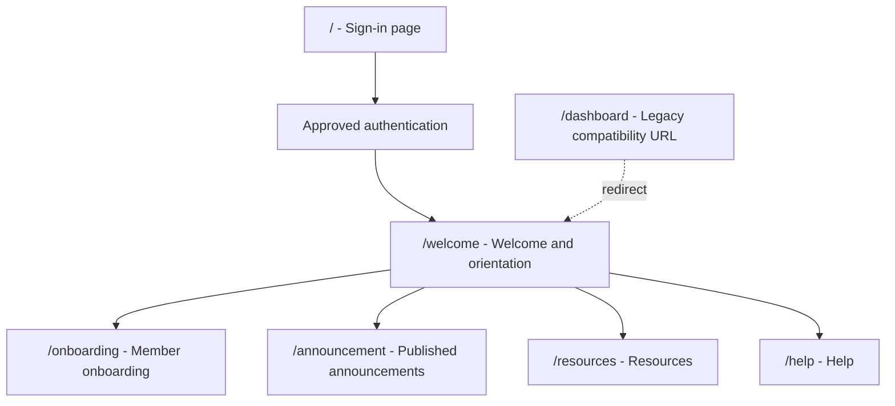

# ADR-0038: Use `/welcome` for the Authenticated Entry Page

- Status: Accepted for implementation
- Date: 2026-10-21
- Owner: To be assigned
- Related work packages: `WP-001`, `WP-002`, `WP-009`, `WP-031`
- Related ADRs: `ADR-0001`, `ADR-0006`, `ADR-0022`, `ADR-0030`, `ADR-0035`

## Context

The authenticated entry page is currently exposed at `/dashboard`, even though it is the first welcome and orientation surface after sign-in. The name `dashboard` implies an operational summary or personalized progress view, while the current page primarily provides the Song Bench home experience, spotlight content, announcements and navigation into Journey and other site areas.

The target onboarding architecture separately defines a member dashboard with assignment progress, next action, blockers and task state. Using `/dashboard` for the current entry page would make that future destination ambiguous and would require another route rename when the member dashboard is implemented.

The sign-in page and local development sign-in path currently navigate to `/dashboard`. Existing documentation, browser tests and users may also use `/dashboard` directly.

## Decision

Rename the authenticated entry page from `/dashboard` to `/welcome`.

`/welcome` is the canonical route for the post-sign-in Song Bench welcome and orientation experience. It may present shared spotlight, announcements and navigation, but it must not claim to be a personalized onboarding dashboard until the assignment model is implemented.

The future personalized member dashboard remains a separate target surface and may use `/dashboard` once its assignment-backed behavior is ready. That future reuse must be introduced deliberately, with an explicit migration note and tests; it must not silently change the meaning of an existing bookmarked URL.

Keep `/dashboard` as a compatibility redirect to `/welcome` during the migration period. The redirect must:

- preserve query parameters where supported;
- use a client-side route redirect only for browser navigation, not as an authorization control;
- be covered by a browser smoke test and direct-navigation test;
- remain until approved consumer and bookmark verification is complete; and
- be removed or reassigned only through a later ADR or an explicit implementation update to this ADR.

Update the sign-in page, navigation documentation, Playwright tests, presentations and SAD references to use `/welcome` as the current entry route. External destination URLs containing the word `dashboard` are unrelated and must not be changed.

## Navigation and authorization

The route rename does not change access policy. The entry page remains available only after the approved authentication flow, except for the isolated local development mode defined by `ADR-0035`. The backend remains the security boundary; hiding `/welcome` or redirecting `/dashboard` in Angular does not grant or revoke access.

The intended navigation is:

## Consequences

Positive consequences:

- The current entry page has a name that matches its welcome/orientation role.
- The future assignment-backed dashboard has a clear, unambiguous route.
- Existing `/dashboard` bookmarks can continue to work during migration.
- The SAD and navigation documentation can distinguish current welcome content from future onboarding progress.

Costs and risks:

- The Angular route, sign-in redirects, tests and documentation need coordinated updates.
- Search results, bookmarks and external links may continue to use `/dashboard` until the compatibility period ends.
- The word `dashboard` remains in unrelated external URLs and domain terminology; those references must not be mechanically renamed.
- A future `/dashboard` implementation must avoid breaking compatibility expectations without a reviewed migration plan.

## Implementation plan

1. Add `/welcome` as the canonical Angular route for the current entry component.
2. Change sign-in and local development navigation to `/welcome`.
3. Retain `/dashboard` as a redirect to `/welcome` and add direct-navigation coverage.
4. Update navigation flows, the SAD, README/presentation references and relevant Playwright tests.
5. Inventory internal links and approved consumers of `/dashboard`.
6. Monitor or verify compatibility usage before removing the redirect.
7. Reserve `/dashboard` for the future assignment-backed member dashboard only after its API, authorization, persistence and acceptance tests exist.

## Verification requirements

- Opening `/welcome` renders the current entry experience after approved authentication.
- Opening `/dashboard` redirects to `/welcome` without exposing unauthenticated content.
- Sign-in and local development sign-in land on `/welcome`.
- Refreshing `/welcome` preserves the authenticated session and page state expected for the current experience.
- Direct navigation and browser back/forward behavior are covered.
- No external URLs containing `dashboard` are changed unintentionally.
- Documentation distinguishes `/welcome` from the future assignment-backed `/dashboard`.

## Implementation boundary

This ADR records the route decision and migration contract. It does not claim that the route has already been changed, that the personalized dashboard exists, or that authentication and authorization are production-qualified.

## 2026-10-21 decision amendment

The product decision has changed: `/dashboard` remains the canonical authenticated route and is the Song Site management hub. The earlier `/welcome` rename described above is superseded and must not be implemented.

The `/dashboard` hub owns shared spotlight, announcements, site navigation and role-specific entry points. It may include an assignment summary and next action when onboarding data is available, but detailed work remains under `/onboarding` and `/onboarding/tasks/:id`. The `/` route remains the sign-in page.

Implementation must update the SAD and related navigation documentation to reflect this amendment. Existing `/dashboard` bookmarks and links remain valid; no compatibility redirect to `/welcome` is required.
