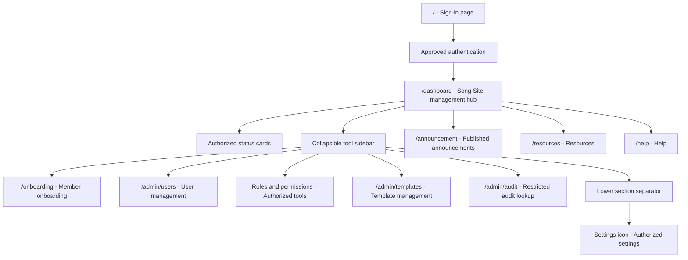

# ADR-0038: Song Site Dashboard Management Hub

- Status: Accepted for implementation
- Date: 2026-10-21
- Owner: To be assigned
- Related work packages: `WP-001`, `WP-002`, `WP-009`, `WP-031`, `WP-042`
- Related ADRs: `ADR-0001`, `ADR-0006`, `ADR-0022`, `ADR-0030`, `ADR-0035`

## Context

The authenticated Song Site needs one consistent management hub after sign-in. The current `/dashboard` route already serves the shared home experience, but its target responsibilities are underspecified. The dashboard must show useful status summaries and provide role-aware access to administrative and operational tools without becoming a second source of truth for status or permissions.

The dashboard must support different users without exposing tools they cannot use. It needs a sidebar that can expose tools such as user management, role and permission administration, templates, audit and settings when authorized. The sidebar must remain usable at narrow widths, support a collapsed icon-only mode, and inherit the existing Song Site theme rather than introducing a separate visual system.

The sign-in page remains `/`. `/dashboard` is the authenticated destination and must remain stable for existing bookmarks and links.

## Decision

Keep `/dashboard` as the canonical authenticated Song Site management hub. Do not create or implement `/welcome` as a replacement route. The `/` route remains the sign-in page.

The dashboard has four responsibilities:

1. Display role-appropriate status cards using server-provided data, such as onboarding progress and blockers, pending content or template work, user/access administration status, and operational notices where the caller is authorized to see them.
2. Provide the primary sidebar navigation for authorized Song Site tools, including user management, roles, permissions, templates, audit and other approved administration tools.
3. Provide a lower sidebar section separated from primary tools, with a settings icon as the entry point for user and application settings that the current principal may access.
4. Provide the shared Song Site shell, including navigation, sign-out and theme inheritance, without owning the underlying domain state or authorization decisions.

Sidebar behavior is part of the dashboard contract:

- The sidebar is expanded by default when the viewport and user preference allow it and can be collapsed without changing the current route.
- Collapsed mode shows icons only; every icon has an accessible name and a tooltip or equivalent discoverable label.
- The separator and settings control remain identifiable in expanded and collapsed modes.
- The collapsed/expanded preference may be presentation state stored for the current browser, but it must not contain permissions or authoritative user state.
- Items are rendered only when the server-resolved principal has the required permission, and every destination and mutation remains server-authorized.

The dashboard inherits the existing Song Site theme tokens, typography, spacing, component states and responsive behavior. It must not introduce an independent theme or hardcode role visibility in the client.

## Navigation and authorization

The dashboard remains available only after the approved authentication flow, except for the isolated local development mode defined by `ADR-0035`. The backend remains the security boundary; sidebar visibility does not grant access and route guards are not a substitute for API authorization.

The intended navigation is:

## Consequences

Positive consequences:

- `/dashboard` has one stable meaning as the authenticated Song Site management hub.
- Users can reach status, onboarding and authorized management tools from one predictable shell.
- Collapsed navigation supports smaller screens and users who need more content width.
- Theme inheritance keeps the dashboard visually consistent with existing Song Site pages.

Costs and risks:

- Status cards require aggregated, permission-filtered API contracts and loading/error states.
- Role, permission and settings tools require separate backend authorization and audit rules.
- Sidebar state, keyboard behavior, tooltips and responsive breakpoints require dedicated frontend tests.
- A broad tool sidebar can become an ungoverned CMS or administration surface unless each tool has an owner and work package.

## Implementation plan

1. Define the dashboard status-card contract in OpenAPI, including per-card permission, loading, empty, stale and error behavior.
2. Implement the shared dashboard shell with expanded/collapsed sidebar states, keyboard navigation, accessible icon labels, separator and settings entry.
3. Reuse the existing Song Site theme tokens and responsive layout primitives; do not create dashboard-only theme values.
4. Add authorized tool entries incrementally: onboarding, users, roles/permissions, templates, audit and settings. Each tool requires an owner, API contract, permission and work package.
5. Keep dashboard summaries read-only and derive them from domain APIs; never calculate authoritative status or permission decisions in Angular.
6. Add two-user and role-specific tests proving that cards and tools are filtered without leaking inaccessible status data.
7. Add Playwright coverage for expanded/collapsed navigation, persistence of presentation preference, keyboard access, responsive behavior and direct route authorization.

## Verification requirements

- Approved sign-in and local development sign-in land on `/dashboard`.
- `/dashboard` renders only status cards and tools authorized for the resolved principal.
- Status cards show server-derived values and honest loading, empty, stale and failure states.
- Expanding and collapsing the sidebar does not change the current route or domain state.
- Collapsed mode exposes accessible names/tooltips for every icon, including settings.
- The lower settings section remains separated and usable in both sidebar modes.
- Keyboard navigation, focus order, responsive layout and inherited theme tokens are tested.
- Direct navigation to an unauthorized tool is rejected by the backend and does not leak its status data.
- Two different users with different permissions see correct, independent dashboard content.

## Implementation update 2026 10 26

The first implementation slice is now in progress on `feature/dashboard-management-hub`.

- `/dashboard` renders the new management shell with an expanded or glyph-only collapsible sidebar.
- `/home` now preserves the former spotlight and announcement Home experience.
- User Management, Roles and Settings have dedicated frontend routes.
- `/api/v1/dashboard/summary` returns server-derived identity and permission-filtered summary cards.
- User Management continues to use the existing backend-protected RBAC read route.
- Permissions administration, onboarding, resource monitoring, audit lookup, templates and production Entra qualification remain deferred; deferred destinations are not exposed as working navigation links.

The sidebar uses local browser storage only for presentation preference. It does not store or grant authorization. Direct routes and API calls remain backend-controlled. This update does not change the accepted decision or silently approve the deferred Permissions capability.

## Implementation boundary

This ADR records the `/dashboard` management-hub and shell contract. It does not claim that status aggregation, all sidebar tools, role/permission administration, settings, responsive collapse behavior or production authorization are implemented. Each tool remains subject to its own API, migration, authorization, test and runbook requirements.
