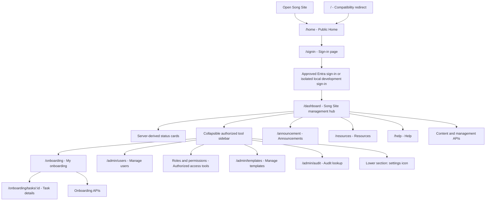
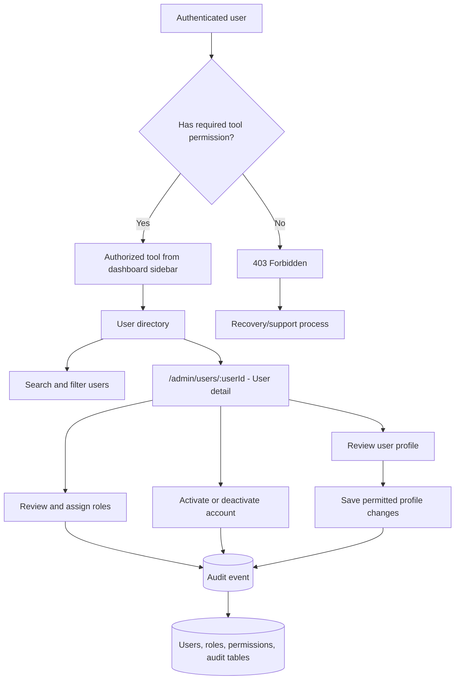

# Navigation Flows

These diagrams distinguish the authenticated `/dashboard` management shell from planned tool destinations. A Mermaid renderer is required to display the diagrams.

## Main site flow

`/home` is the public landing page. `/` redirects to `/home` for compatibility, and Home links to the explicit `/signin` entry point. After approved authentication, `/dashboard` is the Song Site management hub and profile destination. The authenticated shell exposes a top-right account dropdown with the current user's first name, **Profile** → `/dashboard`, a separator, and **Sign off** → `/home`. Local development mode is isolated as defined by `ADR-0035`; it is not guest browsing.

### Current main-flow notes

- `/home` is the public landing page and remains available without authentication.
- `/` redirects to `/home`; `/signin` is the explicit sign-in entry point.
- `/dashboard` is the authenticated Song Site management hub with status cards and a role-aware sidebar.
- `/atcp-song` is a leadership/content page, not a separate admin surface.
- `/contactus` is a general contact form, not user administration.
- The classic `/journey` route remains a separate legacy Journey experience and is not yet the shared database-backed workflow.

## Planned administration tools from the dashboard

The admin flow is designed but not implemented. It depends on authenticated identity claims, backend RBAC, user tables, and audit logging.

### Planned admin boundaries

- Dashboard entry after authentication: `/dashboard`; planned user-management route: `/admin/users`.
- Current User Management APIs: `GET /api/v1/rbac/users` and `PUT /api/v1/users/:userId` for protected profile/status updates. User creation, user detail, and role-management APIs remain deferred.
- Authorization must be enforced by the backend; Angular navigation is not a security boundary.
- Role assignment and account-state changes require audit events.
- Roles, permissions, templates, audit and settings are separate authorized tools; sidebar visibility does not grant access.
- The dashboard sidebar is collapsible, icon-only when collapsed, keyboard accessible and inherits the global Song Site theme.
- Implementation is tracked by `WP-016`; RBAC foundations are tracked by `WP-007`.

## Status

| Flow | Status | Source |
| --- | --- | --- |
| Sign-in and dashboard shell | Implemented locally; management-shell contract planned | `src/app/app.routes.ts`, `src/app/navbar/navbar.html`, `ADR-0038`, `WP-042` |
| Main content API integration | Implemented locally | `backend/server.js`, `backend/database.js` |
| Dashboard administration tools | Planned | `ADR-0015`, `ADR-0038`, `WP-016`, `WP-042` |
| Production authorization | Planned | `ADR-0005`, `ADR-0017`, `WP-018` |
