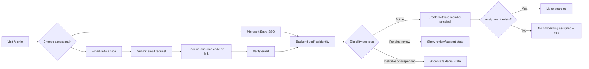

# WP-045: Self-Service Sign-Up and Bench Onboarding Plan

## Purpose

Deliver a self-service path from first visit to the first protected Song Bench onboarding screen. A person must be able to request access, prove control of their email or use approved Entra SSO, receive an eligibility decision, activate a member principal, and reach either an assigned onboarding plan or an honest no-assignment state.

This plan is implementation guidance. It does not approve the unresolved product, identity, privacy or delivery decisions in `ADR-0041`.

## Target experience

## Product states

| State | Meaning | User can do | User cannot do |
| --- | --- | --- | --- |
| `guest` | No verified identity | Request access, sign in, retry | Read portal data |
| `verification-pending` | Request exists and secret is outstanding | Enter code, resend after throttling | Read portal data or create a session |
| `pending-review` | Identity is verified but eligibility is unresolved | See support/review status, sign out | Read onboarding or choose a role |
| `active` | Backend approved member principal | Read own dashboard/onboarding and perform allowed member actions | Assign or verify onboarding |
| `ineligible` | Identity is not eligible for Bench | See generic support guidance, sign out | Read portal data |
| `suspended` | Access revoked or held | See generic support guidance, sign out | Read portal data |
| `active-no-assignment` | Active member has no current plan | See no-assignment state and request help | Invent or self-assign a plan |

## Delivery phases

### Phase 0: Decisions and contracts

- Approve the eligibility source: Entra group/app role, approved email domain plus review, roster feed, or coordinator approval.
- Choose the email delivery service, sender identity, code/link format, expiry, retry and retention policy.
- Define whether activation is automatic for eligible users or requires coordinator approval.
- Name the support/recovery owner and define the response for duplicate, expired, ineligible and suspended requests.
- Add the public and protected API schemas to OpenAPI before implementation.

Exit evidence: approved ADR-0041 decisions, threat model, data-retention decision, API contract and named operational owners.

### Phase 1: Public sign-up and verification

- Add a sign-up entry to `/signin` without creating a password-based account.
- Accept only the minimum input required for the chosen policy, initially email address and optional display name only if approved.
- Normalize email for lookup, store no raw verification secret, and return a generic response for every request.
- Generate a single-use, short-lived verification secret with attempt limits and resend throttling.
- Verify the secret server-side and create a pending identity/session; never accept a client-supplied role, member ID, cohort or eligibility result.
- Support refresh, expiry, resend, cancellation and safe back navigation.

Exit evidence: API tests for generic responses, enumeration resistance, expiry, replay, throttling, malformed input and audit events.

### Phase 2: Identity and eligibility activation

- Resolve Entra and verified-email identities into one backend principal model keyed by provider, issuer and subject.
- Apply the approved eligibility policy and produce `active`, `pending-review`, `ineligible` or `suspended`.
- Create or reconcile the member record idempotently.
- Grant only the baseline member permission when active. Never grant coordinator or administrator permissions through sign-up.
- Emit activation, denial, suspension and recovery audit events.
- Ensure an active identity can access `/dashboard` but receives no onboarding data beyond its own scope.

Exit evidence: identity reconciliation tests, idempotent activation tests, negative authorization tests and audit records.

### Phase 3: Onboarding handoff

- Query for an active assignment owned by the current member.
- If one exists, route to `/onboarding` and render the immutable template snapshot from `WP-043`.
- If none exists, render `No onboarding assigned`, the approved help contact and the next supported action.
- If automatic assignment is approved, create exactly one assignment per member and onboarding cycle from a published template version.
- If coordinator assignment is required, expose a request-help action rather than a self-assignment action.
- Keep assignment ownership and task events in `WP-043`; do not duplicate them in the sign-up domain.

Exit evidence: first-login browser journey for assigned, unassigned, pending-review, ineligible and suspended users.

### Phase 4: Recovery, operations and release

- Implement resend, expired-code restart, logout, session expiry and support recovery.
- Add delivery failure handling without exposing whether the account exists.
- Add metrics for requests, verification success/failure, throttling, activation outcomes and time to first onboarding view. Avoid sensitive email values in logs.
- Document runbooks for delivery outage, abuse spikes, identity mismatch, suspension and manual recovery.
- Qualify against disposable PostgreSQL and the supported local adapter, then run browser and security acceptance tests.

Exit evidence: runbook, dashboards/alerts, migration evidence, browser results, security review and rollback procedure.

## Proposed API surface

| Method | Endpoint | Access | Purpose |
| --- | --- | --- | --- |
| `POST` | `/api/v1/auth/registration-requests` | Public | Start or refresh a verification request with a generic response |
| `POST` | `/api/v1/auth/verification` | Public | Consume a one-time code/link and create a pending session |
| `POST` | `/api/v1/auth/verification/resend` | Public | Request another secret under throttling rules |
| `GET` | `/api/v1/auth/registration-status` | Pending session | Return non-sensitive state and next action |
| `POST` | `/api/v1/auth/activation` | Pending session | Re-evaluate approved eligibility and activate the principal idempotently |
| `GET` | `/api/v1/session` | Public | Return session/access state only, never portal data |
| `GET` | `/api/v1/onboarding/me` | Active member | Return the current assignment or no-assignment state |

All mutation responses use the common error envelope. Public request/verification endpoints use generic responses and never reveal account existence.

## Data model additions

Add or approve the following identity-lifecycle records before onboarding assignment work depends on them:

- `registration_requests`: normalized lookup key, provider hint, state, created/updated timestamps and retention deadline.
- `verification_challenges`: request ID, hashed secret, purpose, expiry, attempts, consumed timestamp and delivery metadata without message content.
- `identity_principals`: provider, issuer, subject, member ID, account state and last verified timestamp.
- `eligibility_decisions`: principal, policy version, outcome, reason code, reviewer/source and timestamps.
- `activation_events`: actor/source, prior state, new state, correlation ID and timestamp.

The existing `members`, `assignments`, `assigned_tasks` and audit records remain owned by `WP-043`. Foreign keys and idempotency constraints must prevent duplicate principals and duplicate active assignments.

## Security and privacy gates

- Generic responses prevent account enumeration.
- Secrets are hashed at rest, single-use, short-lived and attempt-limited.
- Email is proof of mailbox control, not proof of role or Bench eligibility.
- Browser input cannot choose a role, scope, member ID, cohort, assignment or activation outcome.
- Logs exclude verification secrets and minimize email exposure.
- Retention and deletion rules cover pending requests, challenges, rejected decisions and audit records.
- Rate limits and abuse monitoring are required before production enablement.
- Support recovery requires an auditable operator action and must not bypass eligibility.

## Definition of done

- An eligible new user completes sign-up/SSO, verification, activation and first protected onboarding read without administrator intervention.
- A verified but pending-review user receives a safe status and no portal data.
- Ineligible, suspended, expired, replayed and throttled flows are denied without account enumeration.
- Assigned and unassigned active members receive the correct onboarding state.
- Entra and email identities use the same backend authorization boundary.
- OpenAPI, migrations, authorization tests, browser tests and runbooks are complete.
- `WP-045` is not complete until `WP-043` handoff is proven end to end.
